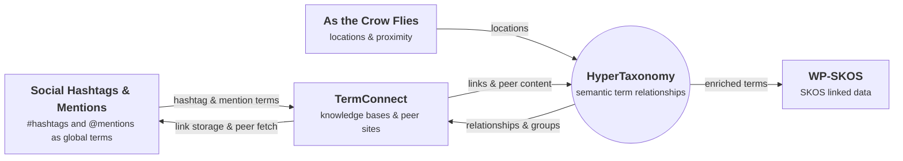

  
  

    <h1 class="hero-title">HyperTaxonomy Suite</h1>
    
HyperText: linking pages. HyperTaxonomy: connecting concepts.

    

      <a class="btn btn-primary" href="#getting-started">Get started</a>
      <a class="btn" href="#the-plugins">Explore the plugins</a>
      <a class="btn" href="https://github.com/HyperTaxonomy">GitHub</a>
    

  

In stock WordPress, a post reaches a tag or category archive only if it carries
exactly the right term. Building a comprehensive site means constant re-tagging,
or accepting gaps. The HyperTaxonomy Suite fixes this at the taxonomy level:
define once how your terms relate to each other, connect that vocabulary to the
wider web, and let every related post surface where it belongs — in archives,
in search results, and in linked-data clients — with no re-tagging.
{: .lead }

  
Why this exists

  
Hypertext connected documents, and in doing so changed how people do almost everything. HyperTaxonomy takes the same step for what those documents are about: it connects concepts — within sites, across sites, and across systems — into a decentralized network of meaning.

  
<a href="">Read the full essay →</a>

## The plugins

The HyperTaxonomy Suite is a set of focused WordPress plugins. **HyperTaxonomy**
is the core and acts as the hub. **As the Crow Flies** is fully standalone. The
other companions build on the same term vocabulary and do more when
HyperTaxonomy is present; **Social Hashtags & Mentions** also requires
**TermConnect**.

  

    

      
      

        <h3>HyperTaxonomy</h3>
        
The core

        
Structure the unstructured

      

    

    
At its simplest, it organizes your terms: arrange tags, categories, and custom terms into nested groups, manage them in bulk, and display them — as term lists, collapsible trees, or filtered tag clouds — anywhere on your site. From there, model any semantic connection in your domain: inclusions (any term pulls in another's posts), synonyms (bidirectional inclusions), and 301-safe redirects. Enrich archives with descriptions, sticky posts, icons, and build faceted search widgets, which can order results relevance among other criteria — all from the WordPress admin, no coding required. As the suite's hub, it also surfaces companion data — locations from As the Crow Flies, identifiers and peer links from TermConnect, etc. — through one term API, so consumers like WP-SKOS read everything in one place.

    

      Requires nothing
      <a href="https://hypertaxonomy.org/hypertaxonomy/">Docs</a><a href="https://github.com/HyperTaxonomy/hypertaxonomy">GitHub</a>
    

  

  

    

      
      

        <h3>TermConnect</h3>
        
Across the web

        
Vocabulary without borders

      

    

    
Connect your term vocabulary to the global web of knowledge. Attach external identifiers (Wikidata, GeoNames, any URI), delegate term definitions to authoritative sources, mirror shared vocabularies from peers, and pull related content from a decentralized network of trusted sites and feeds — curated, not crawled.

    

      Requires nothing · better with HyperTaxonomy
      <a href="https://hypertaxonomy.org/termconnect/">Docs</a><a href="https://github.com/HyperTaxonomy/termconnect">GitHub</a>
    

  

  

    

      
      

        <h3>Social Hashtags &amp; Mentions</h3>
        
Across social networks

        
Hashtags unleashed

      

    

    
Write <code>#hashtags</code> and <code>@mentions</code> inline in the editor and let them turn into real taxonomy terms, assigned to posts automatically from your content. Each token links out to the social networks that you enable in settings — hashtags to a network's hashtag page, mentions to a person's profile. Aggregate content from peer sites by common hashtags dynamically.

    

      Requires TermConnect
      <a href="https://hypertaxonomy.org/social-hashtags-mentions/">Docs</a><a href="https://github.com/HyperTaxonomy/social-hashtags-mentions">GitHub</a>
    

  

  

    

      
      

        <h3>As the Crow Flies</h3>
        
Across space

        
Location management and distance filtering

      

    

    
Attach one or more physical locations (addresses and/or coordinates) to any taxonomy term and filter WordPress content by distance — postal code, browser geolocation, or a chosen reference point. No map API required; works worldwide.

    

      Requires nothing
      <a href="https://hypertaxonomy.org/as-the-crow-flies/">Docs</a><a href="https://github.com/HyperTaxonomy/as-the-crow-flies">GitHub</a>
    

  

  

    

      
      

        <h3>WP-SKOS</h3>
        
Onto the semantic web

        
Your taxonomies, as linked data

      

    

    
Turn any WordPress taxonomy into a machine-readable SKOS vocabulary. Each term becomes a <code>skos:Concept</code> at a stable URI; each taxonomy a <code>skos:ConceptScheme</code>. A Skosmos-compatible REST API and a concept-aware document search endpoint make your vocabulary browsable and queryable by SKOS tools, RAG pipelines, and AI agents.

    

      Requires nothing · better with HyperTaxonomy
      <a href="https://hypertaxonomy.org/wp-skos/">Docs</a><a href="https://github.com/HyperTaxonomy/wp-skos">GitHub</a>
    

  

## The ecosystem

HyperTaxonomy sits at the center as the hub. The arrows show how term data flows:
companions enrich the shared vocabulary, HyperTaxonomy feeds its relationships
back to them, and it exposes the combined picture — through a single term API — to
consumers like WP-SKOS. Every plugin also works on its own.

## Getting started

1. **Install the core.** Add **[HyperTaxonomy](https://hypertaxonomy.org/hypertaxonomy/)**
   and define your term relationships — groups, inclusions, synonyms, redirects.
   This alone improves every archive page and search result on your site.

2. **Add companions as you need them.**
   - Connecting to external knowledge bases or peer sites? Add
     **[TermConnect](https://hypertaxonomy.org/termconnect/)**.
   - Turning #hashtags and @mentions into linked taxonomy terms? Add
     **[Social Hashtags & Mentions](https://hypertaxonomy.org/social-hashtags-mentions/)** (with TermConnect).
   - Working with places and distances? Add
     **[As the Crow Flies](https://hypertaxonomy.org/as-the-crow-flies/)**.
   - Publishing linked data or feeding AI/RAG clients? Add
     **[WP-SKOS](https://hypertaxonomy.org/wp-skos/)**.
